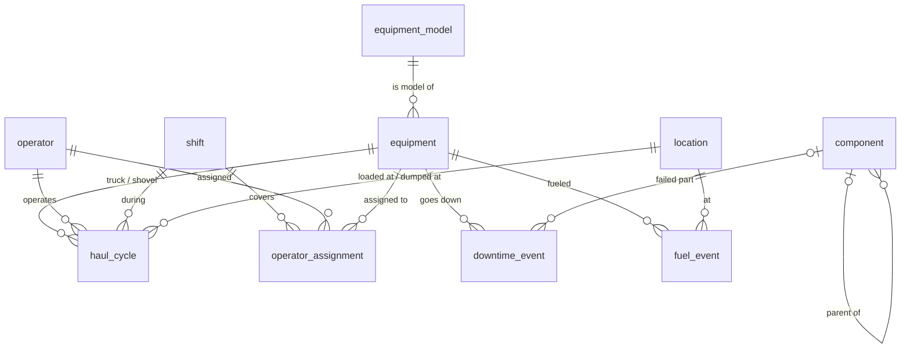

# Haul Fleet Analytics

SQL analytics for a simulated open-pit mine haul fleet, built in PostgreSQL.

The database models six months of haulage operations: 20 haul trucks (Caterpillar 793F and Komatsu 930E) working three shovels on 12-hour day and night shifts, moving ore to a crusher and stockpile and waste to two dumps. It tracks every haul cycle stage, operator assignment, downtime event, and fuel fill. The queries answer the questions a mine operations or reliability team asks every week: how much material moved, where cycle time goes, how available the fleet is, and which equipment performs best.

All data is synthetic, produced by a seeded Python generator, so results are fully reproducible.

## Key findings

- **The fleet moved 36.1 million tonnes in six months,** 10.3 Mt of ore and 25.8 Mt of waste, a strip ratio of about 2.5 : 1. Monthly totals hold steady near 6 Mt, with February lower only because it is shorter.
- **Night shift cycles run 2.2 minutes (8%) longer than day shift** (29.3 vs. 27.1 min). The extra time comes from queueing, loaded haul, and empty return; loading and dumping times are unchanged, which points to visibility and travel speed rather than equipment.
- **Physical availability ranges from 86.7% to 92.5% across the fleet.** Downtime events are clipped to the reporting window, and events still open at period end are counted through the end of the window rather than silently dropped.
- **Truck productivity is decided by model, not by individual truck.** Every 930E outranks every 793F (about 587 vs. 460 tonnes per operating hour, in line with their 290 t vs. 227 t payloads), while trucks of the same model fall within about 1% of each other.

## What this project demonstrates

| Area | Where |
|---|---|
| Schema design: normalization, foreign keys, CHECK constraints | `schema/postgres/schema.sql` |
| Exclusion constraints that block overlapping time ranges (no truck with two operators, no overlapping downtime) | `schema/postgres/schema.sql` |
| Declarative range partitioning of the fact table by month | `schema/postgres/schema.sql` |
| Conditional aggregation with `FILTER` | `queries/01_fleet_kpis.sql` (Q1) |
| Time zone handling for month boundaries | `queries/01_fleet_kpis.sql` (Q1) |
| CTEs, interval clipping, and NULL handling for open events | `queries/01_fleet_kpis.sql` (Q3) |
| Window functions: fleet-wide and partitioned ranking | `queries/01_fleet_kpis.sql` (Q4) |
| Reproducible synthetic data, bulk-loaded with `COPY` | `data/generate.py` |

## Data model



The central table is `haul_cycle`, one row per truck trip, with timestamps for each stage: arrive at shovel, load start, load end, dump start, dump end, and return to shovel. It holds about 150,000 rows and is partitioned by month. `component` is a self-referencing hierarchy (truck > chassis > tires) used to roll failures up to the system level.

All timestamps are stored as `timestamptz`. The mine runs on Arizona time (MST, UTC-7, no daylight saving), and reporting queries bucket dates in that zone.

## Running it locally

Requirements: Docker and Python 3.10 or later.

```bash
# 1. Start PostgreSQL 16 (the schema loads automatically on first start)
docker compose up -d

# 2. Install the database driver and generate the data (about a minute)
pip install -r requirements.txt
python data/generate.py

# 3. Run a query file
docker exec -i haul-fleet-pg psql -U fleet -d haul_fleet < queries/01_fleet_kpis.sql
```

On Windows PowerShell, use this for step 3 instead:

```powershell
Get-Content queries\01_fleet_kpis.sql | docker exec -i haul-fleet-pg psql -U fleet -d haul_fleet
```

The database listens on port **55432** to avoid clashing with any local PostgreSQL install. To connect with a GUI client such as DBeaver or pgAdmin, use host `localhost`, port `55432`, database `haul_fleet`, and user and password `fleet`.

To rebuild from scratch, run `docker compose down -v`, then repeat the steps above.

## Project structure

```
haul-fleet-analytics/
├── schema/postgres/schema.sql     Tables, constraints, partitions, indexes
├── data/generate.py               Seeded synthetic data generator
├── queries/
│   └── 01_fleet_kpis.sql          Tonnes, cycle stages, availability, productivity
├── docker-compose.yml
└── requirements.txt
```

## Roadmap

- [x] Schema, data generator, and Docker setup
- [x] Fleet KPIs: tonnes, cycle breakdown, availability, productivity
- [ ] Cycle time analysis: percentiles, gaps between cycles, outliers
- [ ] Shift and operator performance comparison
- [ ] Downtime analysis: gaps and islands, recursive failure roll-up
- [ ] Query performance tuning with `EXPLAIN ANALYZE`
- [ ] Data quality checks (overloaded trucks, sensor glitches)
- [ ] SQL Server (T-SQL) port and dialect notes

## About

Built by Daniel Challenger, a data engineer with a background in mining and metallurgical engineering (University of Arizona). The scenario draws on real open-pit haulage practice; the data and equipment numbering are invented.
