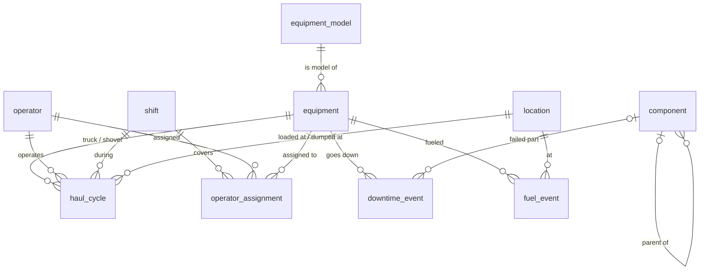

# Haul Fleet Analytics

SQL analytics for a simulated open-pit mine haul fleet, built in PostgreSQL and ported to SQL Server.

The database models six months of haulage operations: 20 haul trucks (Caterpillar 793F and Komatsu 930E) working three shovels on 12-hour day and night shifts, moving ore to a crusher and stockpile and waste to two dumps. It tracks every haul cycle stage, operator assignment, downtime event, and fuel fill. The queries answer the questions a mine operations or reliability team asks every week: how much material moved, where cycle time goes, how available the fleet is, and which equipment performs best.

Over six months the fleet moves 36.1 million tonnes: 10.3 Mt of ore and 25.8 Mt of waste. All data is synthetic, produced by a seeded Python generator, so results are fully reproducible.

## Key findings

**Operators and crews**

- **Operator technique matters far more than the truck.** After normalizing each cycle against the median for its route and shift type, operator speed varies by about 16% from fastest to slowest, while trucks of the same model perform within about 1% of each other. Years of experience do not explain the difference.
- **Crew D outworks crew B under identical night conditions,** moving about 3,300 more tonnes per shift because its operators cycle about 2% faster. Shift-to-shift swings in tonnes come from how many trucks are down, not from crew speed.

**Haul cycles**

- **Night shift cycles run 8% longer** (29.3 vs. 27.1 minutes), all of it in queueing and travel; loading and dumping are unchanged, which points to visibility and travel speed rather than equipment.
- **Short routes are the least predictable.** Shovel queue time varies by about the same amount on every route, so it makes up a larger share of short cycles. Better dispatching would pay off most on the short waste routes.

**Reliability**

- **A few long outages cost the most, and all of them are unplanned.** Gaps between cycles longer than two hours are rare but account for about 60% of time lost between cycles. Every outage lasting more than one shift traces to an unplanned failure, so long outages are a reliability problem, not a scheduling one.
- **Chassis accounts for 44% of unplanned downtime, and the Engine hides in plain sight.** Rolling failures up the component tree shows tires as the worst single part. The Engine's three parts each look unremarkable, but together they nearly match tires, which a part-level report would miss.

## Performance tuning

Measured exercises, each with a reproducible script and a write-up in `performance/tuning_notes.md`:

- **An index on a frequent filter column** cut pages read by 95% (2,348 to 114) and execution time from 11.2 to 1.7 ms, at a cost of about 1.2 MB of index storage.
- **Reading the query plan exposed a schema bug.** Monthly partitions had been created on UTC boundaries, so a query for one mine-local month scanned two partitions. Redefining the boundaries in mine time let a monthly query read a single partition, a sixth of the pages needed when filtering on a non-partition column.
- **A query rewrite beat a composite index.** The index cut pages read by 93% but time by only 20%, because most of the time went into hashing 150,000 rows. Rewriting the anti-join against a table with one row per truck shift made it about 11 times faster with no new index, so the index was not kept.
- **A slow data quality check led to an index that was kept.** One check ran a downtime lookup for each of 150,000 cycles with no usable index, taking about 15 seconds. An index on downtime by truck and start time brought it to about 1 second, and it supports the availability and outage queries too.

## Data quality

`quality/checks.sql` runs nine checks as a single scorecard, one row per check with PASS or FAIL. Payload checks follow the 10/10/20 haulage policy: no load over 120% of truck capacity, and no more than 10% of loads over 110%.

- **286 payload readings (0.19%) are under 10% of truck capacity,** the signature of payload sensor glitches. They should be excluded or corrected before any payload reporting.
- **Payloads comply with policy.** 0.73% of loads exceed 110% of capacity, well within the 10% allowance, and none exceed 120%.
- **All consistency checks pass:** every cycle falls within its shift, uses the right equipment types and crew, sends material to a valid destination, and never overlaps recorded downtime.

## SQL Server port

The schema and six representative queries were ported to SQL Server 2022, chosen to cover the most dialect differences rather than to repeat the analysis. `data/load_mssql.py` copies the data from PostgreSQL with identical IDs, and every ported query was checked against the PostgreSQL result; all match exactly. The differences are documented in [`dialects.md`](dialects.md). The most useful findings:

- **`DATEDIFF` counts boundaries crossed, not elapsed time,** at every unit. Measuring cycle times in seconds silently dropped sub-second precision and changed one result in the fourth decimal place; switching to `DATEDIFF_BIG(microsecond, ...)` made the results identical. The same behavior miscounts years of service unless corrected.
- **`PERCENTILE_CONT` is a window function only in SQL Server,** so percentile queries are restructured to calculate on every row and then group.
- **SQL Server has no exclusion constraints.** Overlapping operator assignments are prevented with unique constraints, since assignments cover whole shifts; overlapping downtime is blocked by a set-based trigger.
- **Partitioning uses a partition function and scheme** instead of separate partition tables, with the same mine-local monthly boundaries.

## What this project demonstrates

| Area | Where |
|---|---|
| Schema design: normalization, foreign keys, CHECK constraints | `schema/postgres/schema.sql` |
| Exclusion constraints that block overlapping time ranges (no truck with two operators, no overlapping downtime) | `schema/postgres/schema.sql` |
| Declarative range partitioning of the fact table by month | `schema/postgres/schema.sql` |
| Conditional aggregation with `FILTER` | `queries/01_fleet_kpis.sql` (Q1) |
| Time zone handling for month boundaries | `queries/01_fleet_kpis.sql` (Q1) |
| CTEs, interval clipping, and NULL handling for open events | `queries/01_fleet_kpis.sql` (Q3) |
| Window functions: fleet-wide and partitioned ranking | `queries/01_fleet_kpis.sql` (Q4) |
| Percentiles with `PERCENTILE_CONT ... WITHIN GROUP` and joining the same table twice | `queries/02_cycle_time_analysis.sql` (Q1) |
| `LAG` to measure gaps between consecutive rows, bucketed with `CASE` | `queries/02_cycle_time_analysis.sql` (Q2) |
| Outlier detection against a per-group median (aggregate CTE joined back to detail rows) | `queries/02_cycle_time_analysis.sql` (Q3) |
| Fair comparison by normalizing against group medians; `RANK` and `NTILE` quartiles | `queries/03_shift_comparison.sql` (Q1) |
| Two-level aggregation (per shift, then per crew) with `STDDEV` and coefficient of variation | `queries/03_shift_comparison.sql` (Q2) |
| `CORR` in an uncorrelated scalar subquery reading the same CTE as the main query | `queries/03_shift_comparison.sql` (Q3) |
| Anti-join with `NOT EXISTS`, gaps-and-islands with `ROW_NUMBER`, and `HAVING` | `queries/04_downtime_gaps.sql` (Q1) |
| Time-range overlap joins, `STRING_AGG`, and `COUNT(column)` vs `COUNT(*)` with LEFT JOINs | `queries/04_downtime_gaps.sql` (Q2) |
| Recursive CTE walking a self-referencing hierarchy | `queries/05_maintenance_tree.sql` (Q1) |
| Recursive ancestor/descendant pairs to roll up totals through a tree | `queries/05_maintenance_tree.sql` (Q2) |
| Reading `EXPLAIN (ANALYZE, BUFFERS)`: seq vs. bitmap vs. index-only scans, partition pruning, hash joins | `performance/` |
| Judging trade-offs: index storage and write cost, CPU-bound vs. I/O-bound plans, rewrites vs. indexes | `performance/tuning_notes.md` |
| Data quality scorecard: `UNION ALL` of checks with per-check pass thresholds | `quality/checks.sql` |
| Defensive validation: LEFT JOINs plus `IS DISTINCT FROM` so broken references fail checks instead of disappearing | `quality/checks.sql` |
| Domain rules in SQL: the 10/10/20 payload policy | `quality/checks.sql` |
| Reproducible synthetic data, bulk-loaded with `COPY` | `data/generate.py` |
| T-SQL: partition functions and schemes, `IDENTITY`, `datetimeoffset`, a set-based trigger replacing exclusion constraints | `schema/mssql/schema.sql` |
| Porting queries between dialects and verifying results match, including diagnosing a precision difference | `queries/mssql/`, `dialects.md` |
| Cross-database data copy with `pyodbc`, preserving IDs and time zones | `data/load_mssql.py` |

## Data model



The central table is `haul_cycle`, one row per truck trip, with timestamps for each stage: arrive at shovel, load start, load end, dump start, dump end, and return to shovel. It holds about 150,000 rows and is partitioned by month, with partition boundaries at midnight mine-local time so each partition matches a reporting month. `component` is a self-referencing hierarchy (truck > chassis > tires) used to roll failures up to the system level.

All timestamps are stored as `timestamptz`. The mine runs on Arizona time (MST, UTC-7, no daylight saving), and reporting queries bucket dates in that zone.

## Running it locally

Requirements: Docker and Python 3.10 or later.

```bash
# 1. Start PostgreSQL 16 (the schema loads automatically on first start)
docker compose up -d

# 2. Install the database driver and generate the data (about a minute)
pip install -r requirements.txt
python data/generate.py

# 3. Run a query file
docker exec -i haul-fleet-pg psql -U fleet -d haul_fleet < queries/01_fleet_kpis.sql
```

On Windows PowerShell, use this for step 3 instead:

```powershell
Get-Content queries\01_fleet_kpis.sql | docker exec -i haul-fleet-pg psql -U fleet -d haul_fleet
```

The database listens on port **55432** to avoid clashing with any local PostgreSQL install. To connect with a GUI client such as DBeaver or pgAdmin, use host `localhost`, port `55432`, database `haul_fleet`, and user and password `fleet`.

To rebuild from scratch, run `docker compose down -v`, then repeat the steps above. Without `-v`, `docker compose down` stops the containers but keeps the data.

**SQL Server (optional).** `docker compose up -d` also starts SQL Server 2022 on port **51433**. Loading it needs Microsoft's ODBC Driver 17 for SQL Server; to use version 18 instead, change the driver name in the `SETTINGS` block of `data/load_mssql.py`.

```powershell
# Create the database, then run schema/mssql/schema.sql against it (for example in DBeaver)
docker exec -it haul-fleet-mssql /opt/mssql-tools18/bin/sqlcmd -S localhost -U sa -P "HaulFleet!2026" -C -Q "CREATE DATABASE haul_fleet"

# Copy the data from PostgreSQL (PostgreSQL must be loaded first)
python data/load_mssql.py
```

To connect with a GUI client, use host `localhost`, port `51433`, user `sa`, password `HaulFleet!2026`, and set `trustServerCertificate=true`.

## Project structure

```
haul-fleet-analytics/
├── schema/
│   ├── postgres/schema.sql        Tables, constraints, partitions, indexes
│   └── mssql/schema.sql           T-SQL port of the schema
├── data/
│   ├── generate.py                Seeded synthetic data generator
│   └── load_mssql.py              Copies the data into SQL Server
├── queries/
│   ├── 01_fleet_kpis.sql          Tonnes, cycle stages, availability, productivity
│   ├── 02_cycle_time_analysis.sql Route percentiles, gaps between cycles, outliers
│   ├── 03_shift_comparison.sql    Operator ranking, crew comparison, experience
│   ├── 04_downtime_gaps.sql       Consecutive idle shifts and their causes
│   ├── 05_maintenance_tree.sql    Component hierarchy and failure roll-up
│   └── mssql/                     T-SQL ports of six representative queries
├── performance/
│   ├── 01_operator_index.sql      Missing index on a filter column
│   ├── 02_partition_pruning.sql   Partition key filters and boundary fix
│   ├── 03_composite_index.sql     Composite index vs. query rewrite
│   └── tuning_notes.md            Measurements, analysis, and decisions
├── quality/
│   └── checks.sql                 Data quality scorecard
├── dialects.md                    PostgreSQL vs. SQL Server differences
├── docker-compose.yml             PostgreSQL 16 and SQL Server 2022
└── requirements.txt
```

## About

Built by Daniel Challenger, a data engineer with a background in mining and metallurgical engineering (University of Arizona). The scenario draws on real open-pit haulage practice; the data and equipment numbering are invented.
